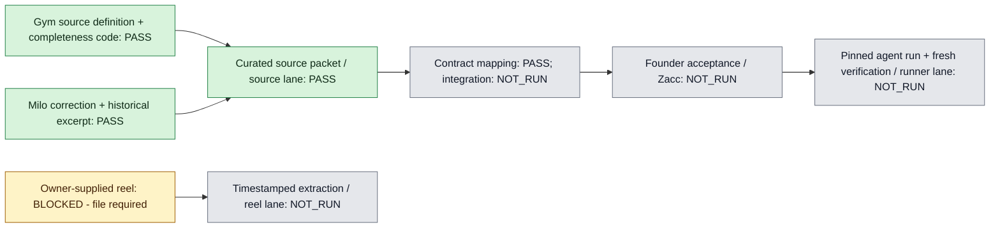

# Curated source packet

Captured 2026-11-04, America/New_York. Scope: `data/curated/` and `docs/sources/` only. Original Gym, Milo and context repositories were inspected read-only. No database or production reads, private histories, confidential receipts, full decks, credential reads, browser activity or external publication occurred.

## Import status

**OWNER_APPROVED; DATABASE_IMPORT_PENDING.** Six exact candidate versions were approved by direct owner message in this source chat; `owner-approval.json` binds that message to the unchanged import bundle. No target database acceptance has yet been verified. Original import rows remain proposed for the integrator to accept through `founder_approver`. `acceptance-evidence.json` distinguishes source-reported owner rulings from founder approval in the hackathon system. Import must not manufacture an approval timestamp or approving identity. The daily reviewer may propose a repair but must never approve it.

## Files

- `data/curated/sources.json`: seven minimal source records with repository HEAD, working-file SHA-256, tracked-change observation, source locator and sanitized excerpt.
- `data/curated/decisions.proposed.json`: six version-1 portable candidates.
- `data/curated/import.contract.json`: final exact-column source and decision rows for `001_core.sql`; UUIDs and profile scopes are resolved.
- `data/curated/import-id-map.json`: portable-slug to stable UUID/decision-key mapping.
- `docs/sources/import-verification.json`: successful ephemeral PGlite import receipt.
- `docs/sources/contract-binding.json`: contract/schema hashes and deadline/ownership discrepancy notes.
- `data/curated/acceptance-evidence.json`: approval evidence and its limits.
- `data/curated/milo-slide-text.json`: one genuine historical conflicting excerpt and one authored, nonfinancial revision candidate. Neither is presented as a fresh model run.
- `data/curated/reel-input-status.json`: owner file dependency, without invented media or extraction.
- `docs/sources/verification.json`: focused packet checks, source binding and missing gates.

## Source interpretation

Gym's canonical definition is one client-backed `MATCHED_INDIVIDUAL` row from the latest complete official Memberships By Status projection. PIF is included; business classes and extra active memberships per client are excluded. `member-contract.ts` contains a legacy SQL fallback when no complete sync exists; that fallback is implementation evidence, not a substitute for the hackathon's required official definition.

`owner-membership.ts` adds an important completeness guard: it selects the latest sync attempt per location and reports partial if that attempt is incomplete, lacks dates, or fails row/key/class reconciliation. It does not silently skip a newer failed attempt to display an older complete run. The imported Gym handler must expose incomplete coverage and preserve actual source dates. No live count or data-age claim is established by this packet.

`projects/gym-nyc/DECISIONS.md` is predominantly a proposed Blueprint register. It does not establish founder acceptance for the active-membership definition. Its broad content is intentionally not imported.

Milo's `COMPANY.md` has a current positioning paragraph followed by older framing and traction language. Only the explicit current-positioning paragraph is excerpted. `projects/milo/STARTUP.md` supplies the narrow relationship and alpha-evidence corrections. The fee ledger states that activation/collections are not verified; its financial value is omitted from every exported file. Original restricted deck contents and partner numbers are not exported.

The historical draft line “The founder’s own gym: the first operations fee” is confirmed at the pinned deck JSON path. This demonstrates a genuine historical conflict with the newer relationship correction. It is historical evidence, not a staged fresh-run failure. If the baseline agent does not drift, show that honestly.

## Integration

1. Claude, the sole integration owner, copies the packet's two target directories into the new repository; no source application paths are changed by this packet.
2. Read the current `docs/CONTRACT.md` before loading records. The contract is now read and bound in `contract-binding.json`. `import.contract.json` matches the actual source and decision columns and passed an ephemeral PGlite insert as `gate_service`. No shared-checkout write or live import occurred.
3. Map each source locator into the contract's `sources` shape. Preserve `file_sha256`, revision, excerpt and historical/proposed labels in retained evidence. `sources.json` hashes the complete unexported source file; `import.contract.json` hashes the exact sanitized excerpt. Only selected excerpts are exported.
4. Resolve stable source IDs before inserting decisions. Use the stable UUIDs and key mapping already supplied in `import-id-map.json`. Keep candidates `proposed`; leave acceptance fields null. Do not use an agent-worker path to alter protected decisions or checks.
5. Ask Zacc to approve the exact candidate versions in the target approval flow. Only that event may create accepted memory. A proposal-to-accepted transition must retain its source and founder event.
6. Use the historical slide text as labeled input, pin accepted decision versions for the run, preserve actual model output and evaluations, and run fresh verification through the runner. The suggested revision is a candidate, not runtime proof.
7. Reel lane receives one owner-supplied allowed file and records its actual hash and extraction. This source lane found no file path in the supplied task material and did not search personal files.

Source retrieval and packet validation do not establish Supabase insertion, Sodabase verdicts, database enforcement, founder acceptance, model execution, reel extraction or fresh-run success.

## Lane map

No chat-activity status is represented as a capability pass. Target integration deadline is 17:40 ET; work-ready cutoff 18:00 ET; final cutoff 18:30 ET on 2026-11-04. No release or acceptance deadline is moved by this packet.

Focused import verification: seven sources and six proposed decisions inserted successfully against the actual migration in local ephemeral PGlite. Accepted count remained zero; an agent-worker acceptance attempt was rejected. This is packet compatibility proof only.

## Local acceptance update

The governor imported and accepted all six exact approved version-1 decisions in persistent **local PGlite**. `local-approved-import-receipt.json` matches the approved bundle hash and retains the direct owner-message reference. Hosted Supabase acceptance and a fresh actual agent run remain unverified, pending the existing Claude integration. Original import rows remain proposed to preserve the approved import payload. No additional founder approval is required for those exact versions.
